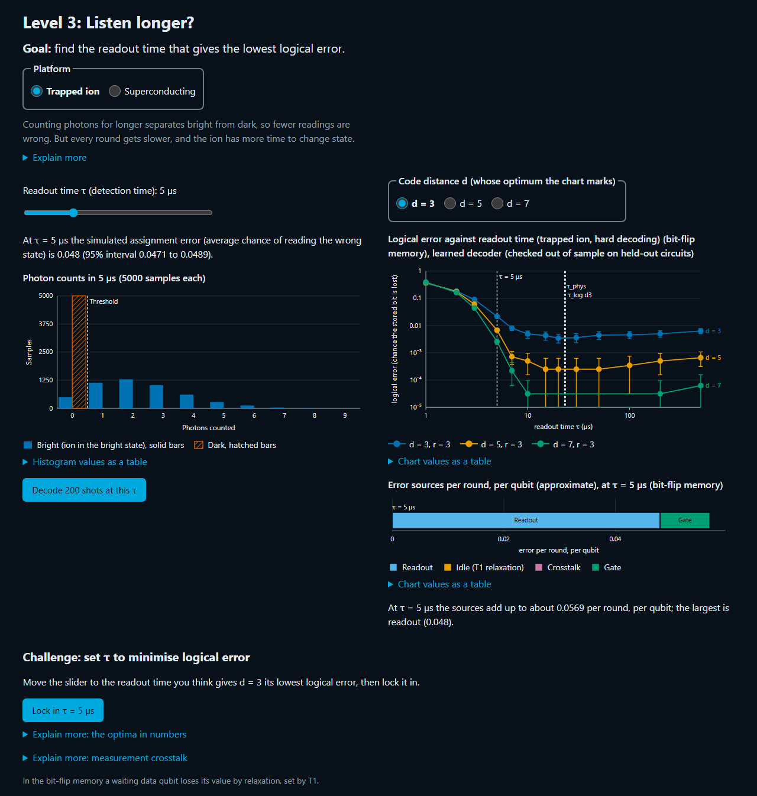
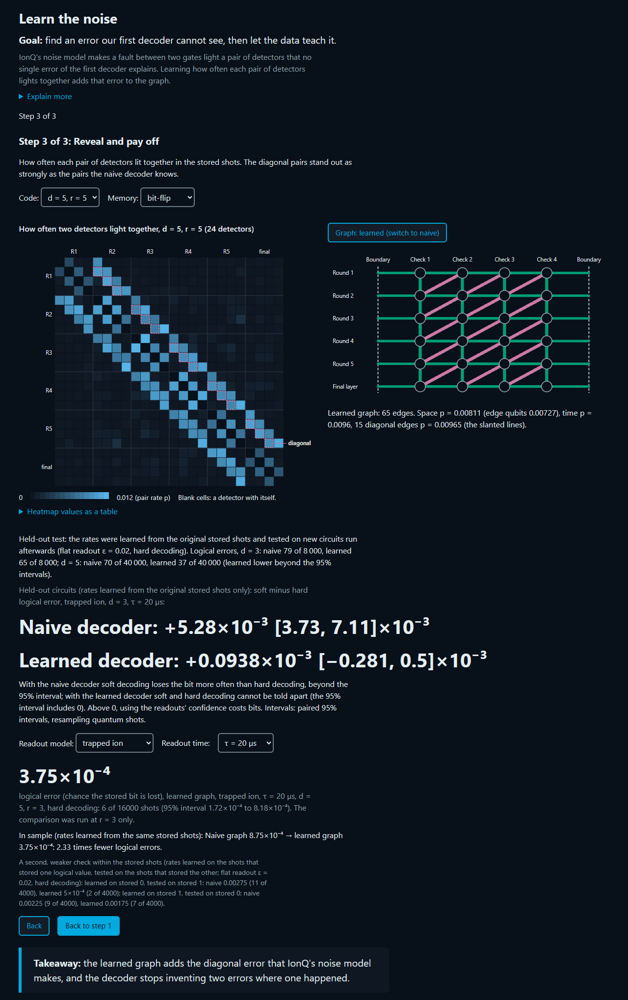

# Signal to Syndrome

**How long should you listen to a qubit? Longer gives a cleaner reading, but the rest of the error-correcting code keeps ageing while you wait. Signal to Syndrome is a browser lab, built on IonQ's simulator, that finds the readout time that actually minimises a code's logical error. Along the way it shows that the decoder's model of the noise matters more than the readout time.**

**[Try it on Qollab](https://qollab.xyz/u/SQuant/main-project)**: nothing to install, and every result is embedded in the page.



**Contents**

- [In 30 seconds](#in-30-seconds)
- [What we found](#what-we-found)
- [Why a repetition code, and why a simulator?](#why-a-repetition-code-and-why-a-simulator)
- [Run it](#run-it)
- [Repository layout](#repository-layout)
- [Authors](#authors)
- [AI assistance and planning disclosure](#ai-assistance-and-planning-disclosure)
- [Licence](#licence)

## In 30 seconds

- **Headline: the data alone revealed an error our first decoder missed, and modelling it cuts the logical error 4×.** Correlations between detectors showed that a fault between a data qubit's two gates is about as common as a wrong check reading. The simple decoding graph, which models only data-qubit flips and wrong check readings, has no edge for it. Circuit-level models include it, but they need the circuit's noise model; our method finds it from the detector data alone, which is what real hardware provides. On held-out IonQ-simulator circuits (new seeds, never used for training), adding it takes the trapped-ion d = 5 memory from 0.090% to 0.021% logical error (at the lowest-error readout time on the grid; the d = 5 optimum itself is not resolved), and going from d = 3 to d = 5 then suppresses errors **15×** instead of 5.4×, so extra qubits pay off.
- **Both kinds of error.** A switch at the top of the page shows the bit-flip memory (0 ↔ 1 errors) or the phase-flip memory (sign errors). The headline numbers come from the bit-flip memory, where the held-out test ran.
- **Practical takeaway: single-qubit readout tuning is enough for the ion, not for the superconducting bit-flip memory.** On the trapped ion, the readout time that is best for the code can't be told apart from the best time for a single qubit. On the superconducting qubit, the bit-flip memory's best readout time is resolved shorter than a single qubit's (0.73 µs against 0.91 µs at d = 3), because the waiting qubits decay during readout; in the phase-flip memory, where idling is weaker, the shift is not resolved.
- **For trapped ions: idling never sets the readout time.** At the ion's best readout time, waiting qubits lose 1.2 × 10⁻⁶ per round to decay, about 500× less than readout error and 7000× less than gate error. Optical pumping sets the clock, and gates set the limit.

## What we found

**F1 (headline). The data revealed a missing error, and modelling it makes the code work on fresh circuits.** Our first decoder used one error rate per edge, and with it, using each readout's confidence ("soft decoding") made the ion *worse*. Measuring how often pairs of detectors fire together ([`src/core/dem.js`](src/core/dem.js)) showed why: an error between a data qubit's two gates lights a diagonal pair of detectors, the simulator produces it about as often as a wrong check reading, and the simple decoding graph (data-qubit flips and wrong check readings only) has no edge for it. Circuit-level models include such edges, given the circuit's noise model; the correlations found it without one. The learned decoder adds those edges and learns one rate per edge class from the same correlations. We found this after seeing the data, so we tested it on 12 new simulator banks:

| Held-out ion circuits, best readout time | First decoder | Learned decoder | Gain |
|---|---|---|---|
| d = 3, hard decoding | 0.48% | 0.32% | 1.5× (not resolved) |
| d = 3, soft decoding | 1.03% | 0.32% | 3.2× |
| d = 5, hard decoding | 0.090% | 0.021% | **4.2×** |
| d = 5, soft decoding | 0.10% | 0.020% | 5.0× |
| Error suppression from d = 3 to d = 5 (hard) | 5.4× | **15×** | |
| Settings where soft decoding hurts | 13 of 26 | **0 of 26** | |



The gain grows with distance; at d = 3 with hard decoding, the two decoders' cluster intervals overlap, so that gain is not resolved. The headline uses hard decoding, where only the noise model changes; the soft gains also include repairing the first decoder's soft decoding, which was worse than hard. The d = 5 rows are read at 27.4 µs, the lowest-error point of the readout-time grid: the d = 5 optimum itself is not resolved (the curve is flat there), and the ablation below, at a fixed 100 µs, gives the same gain.

**Which part does the work?** An ablation on the same held-out circuits ([`tools/ablation.mjs`](tools/ablation.mjs)) separates the two changes. Adding the diagonal edges alone, at one uniform rate, gives the whole hard-decoding gain at d = 5 (0.097% → 0.022%); learned rates alone move it only a little (0.086%), and once the diagonal edges are in, learning the rates adds nothing we can resolve at d = 5 (0.025%, inside the uniform-rate interval). At d = 3 the learned rates add a smaller further gain (0.32% against 0.40% with one uniform rate, below that version's interval). The diagonal edges also carry the soft-decoding gain (d = 5: 0.16% → 0.019%). Learned rates alone only bring soft decoding back to the hard level (0.086%): the single calibrated rate (0.013) absorbs the missing diagonal errors and sits about 40% above the true gate rates (0.007–0.010), so it drowns out the readout's confidence. So the finding is mainly the missing error, not finely tuned rates. The learned model also holds up as a model: rates re-learned from the held-out banks match the trained ones, they are stable across 16 banks and d = 3, 5 and 7, and detector pairs with no edge between them show 150× less correlation than the diagonal pairs.

**F2. Superconducting qubit: the bit-flip code wants a shorter readout than a single qubit; the phase-flip code does not.** In the bit-flip memory, idling during readout pulls the code's best readout time earlier: 0.73 µs (0.70–0.84 µs) against 0.91 µs for a single qubit, and the logical error at 0.9 µs is resolved above that at 0.75 µs at d = 3 and 5. In the phase-flip memory, where idling is weaker, the shift is within the noise (0.70 µs, 0.69–0.95 µs). The pre-registered hypothesis (C1) asked for the shift in both memories, so it is refuted. On the ion, the code's best readout time (23.5 µs, 17.3–25.1 µs) contains the single-qubit 23.0 µs.

**F3. Trapped ion: optical pumping, not idling, sets the readout time.** Photons keep making the reading cleaner until the detection light pumps the ion between states. Idling during the readout never moves the optimum. Measurement crosstalk would only start to move it above about 10⁻³ per µs, about 60× the published rate, which gives a concrete crosstalk budget for ion hardware.

Intervals, sources and the pre-registered hypotheses are in the [full write-up](docs/project_page.md).

## Why a repetition code, and why a simulator?

- **It isolates readout.** The question is how readout physics sets the logical error. A repetition code has little else in the way: its decoder is exact minimum-weight matching (checked against PyMatching, though not a maximum-likelihood decoder), so with the decoding graph held fixed, every change in the logical error comes from readout, idling or the noise model.
- **A controlled comparison needs shared gate noise.** Both platforms decode *the same* IonQ-simulator measurement banks, so the trapped ion and the superconducting qubit differ only in readout physics, idling and cycle time. Real hardware can't hold the gate noise fixed between two platforms.
- **It still covers the whole loop.** Real Qiskit circuits run on IonQ's forte-1 noise model in native gates, with bit-flip and phase-flip memories, d = 3, 5 and 7, three rounds, an exact minimum-weight matching decoder checked against PyMatching, and a live-run button that submits a fresh job.
- **The learned decoder is built for hardware.** It learns its noise model from the detector data alone, so the next step is one bank on Forte hardware, comparing the learned edge rates with the simulator's. A surface code needs a 2-D detector layout and new edge classes; the matching decoder already works on any graph, and the correlation method that learns the rates carries over.

## Run it

- **Main lab:** https://qollab.xyz/u/SQuant/main-project. Use a Chromium-based browser (Chrome, Edge or Opera). All data are embedded, so it makes no network requests.
- **Bank generator** (the IonQ-simulator circuits that produced the data): https://qollab.xyz/u/SQuant/signal-to-syndrome-bank-genera
- **Live run (optional):** select IonQ Forte 1 in Qollab's Select QPU dialog, open Level 4 and press the live-run button. Each press submits one d = 3, r = 3 job (200 shots) through [`qollab/live.py`](qollab/live.py).

Locally, with Node.js 20 or later:

```bash
npm install
npm test
npm run build
npm run check
```

`npm run build` writes `dist/qollab/` (the three files uploaded to Qollab, alongside `qollab/live.py`) and `dist/local/preview.html`, a single file that opens without Qollab. `node tools/sweep.mjs --stage 1` (through `--stage 4`) regenerates `data/results/*.json`; `node tools/ablation.mjs` regenerates the ablation (`data/results/ablation.json`).

## Repository layout

- `src/core/`: decoder, detectors, learned error model, readout models and statistics (ES modules, no runtime dependencies)
- `src/ui/`: the page (hero, findings, levels 1–5, charts, live run)
- `qollab/`: Python that runs on Qollab (bank generator, live-run helper)
- `data/`: IonQ-simulator measurement banks (including the 12 held-out banks) and results
- `params/`: parameter cards, with a source for every value
- `tools/`, `tests/`, `validation/`: build, sweeps, release check, Node tests and Python validation
- `docs/`: [full write-up](docs/project_page.md), [methods and sources](docs/METHODS.md), screenshots

## Authors

- Soumyajit Pal: physics and data
- Sahil Prabhudesai: decoder, interface and platform

## AI assistance and planning disclosure

- **Planning documents written before the build window.** The project plan, the execution checklist, the team checklist (including the Claude Code prompts in them) and the parameter-card templates were written before the window opened, and are disclosed as such. They are not part of this repository.
- **Work before the window.** We prototyped the pipeline and ran early simulator banks on 7–9 Oct, before the window. Every measurement bank and result in this submission was regenerated inside the window with new simulator seeds (data/raw/RERUN_SEEDS.md); the pre-window banks are kept unchanged in archive/pre-window/. On the fresh seeds, F1 replicated within its intervals (the d = 5 gain, the 15× suppression and "13 of 26 → 0 of 26"), but not everything did: the superconducting bit-flip memory now shows a resolved shorter best readout time than a single qubit (before, the shift was within the noise), and the ion's d = 5 best readout time is no longer resolved. Every old and new number is compared in docs/RERUN_DIFF.md.
- **AI assistance.** All code in this repository was generated with Claude Code (Anthropic), an AI coding assistant, following those prompts under the authors' direction. Every change was reviewed by the authors, cross-reviewed by the other team member, and checked by tests and the validation checks V1–V10. The project page and this README were drafted with Claude Code from the repository's own results files and edited by the authors.
- **Reference code.** `docs/qollab_js_api_example.txt` is Qollab's own example of calling the IonQ backend from JavaScript, copied as a disclosed reference.
- The physics derivations, the choice of parameters and their sources, and the conclusions are the authors' responsibility.

## Licence

MIT. See [LICENSE](LICENSE). Copyright (c) 2026 Soumyajit Pal and Sahil Prabhudesai.

This effort is supported by Qollab & IonQ.
